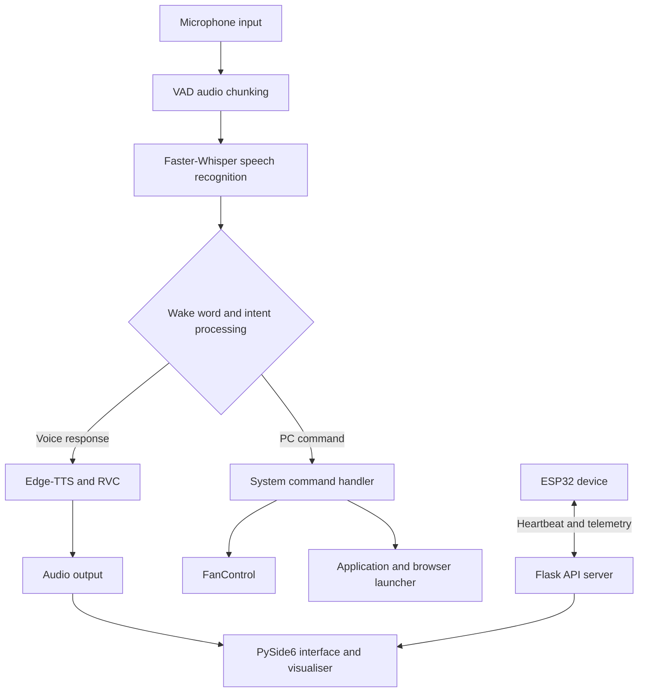

<div align="center">

# SARA
### Hoshikawa Sara Voice Assistant & PC Control Center

**A local-first desktop companion for voice interaction, PC automation, and hardware monitoring.**

[](https://www.python.org/)
[](https://pytorch.org/)
[](https://www.qt.io/)
[](https://flask.palletsprojects.com/)
[](LICENSE)

[Overview](#overview) · [Features](#features) · [Architecture](#architecture) · [Tech Stack](#technology-stack) · [Setup](#getting-started) · [Usage](#usage) · [Troubleshooting](#troubleshooting) · [Roadmap](#roadmap)

</div>

---

## Overview

**SARA** is a custom Windows desktop assistant that combines voice-based interaction with practical PC controls and hardware telemetry. It uses a PySide6 interface, local speech-recognition processing, and a voice-synthesis pipeline to provide an interactive desktop experience.

Alongside conversational features, SARA can launch applications and websites, switch supported FanControl profiles, and receive telemetry from an external ESP32-based device through a lightweight Flask server.

> **Design goals:** local-first processing, a responsive desktop interface, and a single place to interact with PC and connected-device features.

## Features

### Voice interaction

- **Speech recognition:** Uses Faster-Whisper for local speech-to-text processing, with CUDA acceleration where supported.
- **Voice output:** Combines Edge-TTS with local Retrieval-Based Voice Conversion (RVC) model weights.
- **Wake-word handling:** Supports name-based wake triggers and a time-limited follow-up instruction window.
- **Audio feedback:** Displays live audio-reactive visualisation in the desktop interface.

### Desktop interface

- **PySide6 GUI:** Custom widgets, rounded progress bars, ribbon-style elements, and dynamic layout scaling.
- **Audio spectrum visualiser:** Displays 32 frequency bars that react to audio output.
- **Wallpaper transitions:** Rotates wallpapers from local asset directories using dual-column sliding transitions.

### PC and hardware control

- **Fan profiles:** Switches between configured FanControl profiles, such as Normal, Max, and Custom.
- **Application launcher:** Searches for executable files (`.exe`) and shortcuts (`.lnk`) to launch installed applications.
- **Browser routing:** Opens URLs using supported browsers, including Chrome, Opera GX, and Edge.
- **ESP32 telemetry:** Receives heartbeat and connection-status updates from an external ESP32-based DNS sinkhole/ad-blocking device through the Flask server.

## Architecture

SARA separates the desktop interface, audio processing, command handling, and local API routing so that background tasks can run without blocking the GUI.



## Technology Stack

| Area | Technology | Role |
|---|---|---|
| Language | Python 3.10+ | Main application logic and task orchestration |
| Desktop GUI | PySide6 | Window, widgets, and visual feedback |
| Speech recognition | Faster-Whisper, PyTorch | Local speech-to-text processing |
| Voice synthesis | Edge-TTS, RVC | Speech generation and voice conversion |
| Backend | Flask | Local API endpoints for device telemetry |
| Audio | SoundDevice, NumPy, SoundFile | Audio capture, processing, and playback support |
| System integration | Win32 APIs, Subprocess, Glob | Process control, application launching, and file discovery |
| External hardware | ESP32 | Device heartbeat and telemetry source |

## Project Structure

```text
SARA-Voice-PC-Control/
│
├── wallpapers/                   # Wallpaper image assets
├── Icon/                         # Application icons and UI assets
├── FanControl.Releases-master/   # FanControl binaries and profiles
│
├── tts_engine.py                 # Edge-TTS and RVC synthesis wrapper
├── adblock_monitor.py            # ESP32 telemetry monitoring
├── sara_core.py                  # Main GUI, audio, and application logic
├── Start Server.bat              # Application launcher
└── requirements.txt              # Python dependencies
```

## Getting Started

### Requirements

| Requirement | Details |
|---|---|
| Operating system | Windows 10 or Windows 11 (64-bit) |
| Python | Python 3.10 or later |
| GPU | NVIDIA GPU recommended for CUDA-accelerated inference |
| Other software | Git; compatible NVIDIA drivers if using CUDA |

### 1. Clone the repository

```bash
git clone https://github.com/your-username/SARA-Voice-PC-Control.git
cd SARA-Voice-PC-Control
```

Replace `your-username` with the repository owner's GitHub username.

### 2. Create a virtual environment

```bash
python -m venv venv
```

Activate it using the command for your terminal:

**PowerShell**
```powershell
.\venv\Scripts\Activate.ps1
```

**Command Prompt**
```cmd
venv\Scripts\activate.bat
```

### 3. Install dependencies

```bash
python -m pip install --upgrade pip
pip install -r requirements.txt
```

### 4. Install PyTorch with CUDA support

If you are using a compatible NVIDIA GPU, install the PyTorch build that matches your CUDA environment. For example, the following command installs the CUDA 12.1 build:

```bash
pip install torch torchvision torchaudio --extra-index-url https://download.pytorch.org/whl/cu121
```

Check the [official PyTorch installation guide](https://pytorch.org/get-started/locally/) if you need a different CUDA build.

## Configuration

Before launching SARA, check the following local assets and settings:

| Component | Configuration |
|---|---|
| Wallpapers | Add `.png`, `.jpg`, or `.webp` files to `wallpapers/`. |
| Fan profiles | Place or configure profiles such as `Normal.json` and `Max.json` in the relevant FanControl configuration directory. |
| RVC voice model | Place the required `.pth` model weights in the model directory configured in `tts_engine.py`. |
| ESP32 telemetry | Configure the device and network settings expected by `adblock_monitor.py`. |

The exact model paths, profile names, and device settings depend on your local configuration.

## Usage

### Launch SARA

From the project root, run:

```cmd
"Start Server.bat"
```

The launcher is intended to check/update the `edge-tts` dependency and start the application process in the background.

### Voice command examples

| Action | Example phrase |
|---|---|
| Wake SARA | “Sara” or “Hoshikawa” |
| Set fans to maximum | “Sara, fans to max” |
| Restore normal fan profile | “Sara, fans to normal” |
| Launch an application | “Sara, launch Chrome” |
| Open a URL in a browser | “Sara, open youtube.com using Opera GX” |

After the wake word is detected, SARA opens a follow-up instruction window that remains active for approximately 30 seconds.

## Troubleshooting

| Issue | Checks |
|---|---|
| No audio output | Confirm that the intended device is selected as the Windows default playback device. SoundDevice uses the active audio endpoint. |
| RGB or hardware-control conflicts | Avoid running multiple hardware-control utilities that may access the same controller or SMBus resources. |
| Module not found | Activate the project's virtual environment and install the dependencies from `requirements.txt`. |
| CUDA or inference issues | Confirm that the NVIDIA driver and installed PyTorch CUDA build are compatible. |
| ESP32 telemetry not updating | Check the device's network connection and the Flask server configuration. |

## Roadmap

- [x] Local Faster-Whisper speech-recognition pipeline
- [x] Edge-TTS and RVC voice-output integration
- [x] PySide6 desktop interface with audio visualisation
- [x] FanControl profile automation
- [x] ESP32 telemetry monitoring
- [ ] Expand the plugin system for custom smart-home and IoT actions
- [ ] Add containerisation and cross-platform desktop packaging

## Contributing

Suggestions, bug reports, and feature requests are welcome.

1. Fork the repository.
2. Create a feature branch: `git checkout -b feature/your-feature`.
3. Commit your changes: `git commit -m "Add your feature"`.
4. Push the branch: `git push origin feature/your-feature`.
5. Open a pull request.

## License

SARA is distributed under the **MIT License**. See the [`LICENSE`](LICENSE) file for details.
